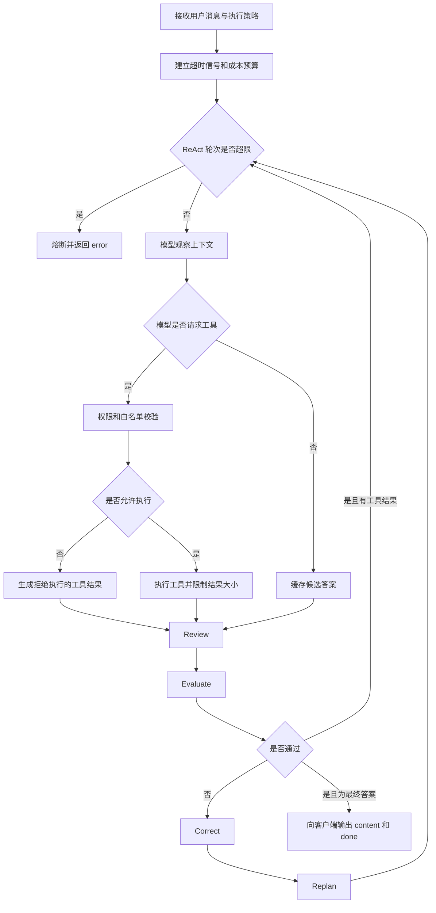

# ReAct + Reflection 企业级双闭环 Agent 设计说明

本文解释项目中 [`NewToolService`](./src/aiModule/new.toolService.ts) 的设计。该服务在普通的工具调用 Agent 上增加了两层闭环：外层使用 ReAct 驱动模型、工具与环境交互，内层使用 Reflection 对每轮结果执行 `Review → Evaluate → Correct → Replan`。同时，每条执行路径都受到轮次、时间、权限和成本约束。

## 1. 为什么需要双闭环

普通工具调用流程通常是：用户提问，模型选择工具，程序执行工具，再把结果交给模型生成答案。这种流程可以完成任务，但存在几个生产风险：

- 模型可能选择错误工具或生成错误参数。
- 工具执行成功，不代表结果符合用户目标。
- 模型可能忽略工具错误并生成看似合理的答案。
- 模型可能不断调用工具，形成循环。
- 未受限制的 Agent 可能调用用户无权使用的工具。
- 多轮模型调用和长上下文可能产生不可控成本。

双闭环将“执行”和“质量控制”拆开：

1. **ReAct 执行闭环**负责观察上下文、选择行动、调用工具并吸收结果。
2. **Reflection 校验闭环**负责审查执行结果、判断偏差、生成修正方案并重新规划。

模型生成的最终答案不会立即发给客户端。只有通过 Reflection 校验后，服务才产生 `content` 和 `done` 事件。这可以避免已经向客户端输出错误内容后再尝试撤回。

## 2. 总体执行流程



整个流程中，模型请求、工具请求和反思请求共享同一个超时信号与成本预算。任何一个约束触发后，Agent 都会停止后续执行。

## 3. 外层 ReAct 执行闭环

ReAct 可以理解为 `Observe → Reason → Act → Observe`。这里的 Reason 是模型内部决策，不要求模型向客户端输出思维链。

### 3.1 Observe：观察

每一轮开始时，模型收到 `workingMessages`：

- 原始用户消息；
- 前几轮 assistant 的工具调用；
- 对应的 tool 执行结果；
- Reflection 产生的纠正和重新规划指令。

因此模型能够基于真实执行结果继续处理任务，而不是每轮从头开始。

### 3.2 Act：选择行动

`runModelRound()` 发起流式模型请求，并聚合两类输出：

- 普通文本，暂存在 `content` 中；
- `tool_calls` 增量，按照 `index` 合并为完整的函数调用。

工具调用参数在流式传输中可能被拆成多个片段，因此不能收到一个片段就立即执行。服务会等待当前模型流结束，再检查 `id`、工具名和完整参数。如果 `finishReason` 为 `length` 且存在未完成的工具调用，服务返回 `TOOL_CALL_TRUNCATED`，不会执行残缺参数。

### 3.3 Tool Observation：工具结果成为下一轮观察

执行完成后，`appendRoundMessages()` 会加入两类消息：

```text
assistant(tool_calls) → tool(result) → 下一轮模型请求
```

工具执行失败也会被序列化为 tool 消息交给模型。这样模型可以根据错误修改参数或选择其他方案，而不是让一次工具错误直接破坏整个会话。

## 4. 内层 Reflection 校验闭环

每轮 ReAct 执行结束后，`reflect()` 会获得本轮候选答案、结束原因、工具调用和工具结果。审查器只返回结构化结论，不输出隐藏思维链。

### 4.1 Review：审查

Review 核对：

- 本轮行为是否仍然围绕用户目标；
- 使用的事实是否来自上下文或工具结果；
- 工具参数与返回结果是否一致；
- 是否出现工具失败、缺失信息或不安全行为。

输出中的 `review` 是简短审查摘要。

### 4.2 Evaluate：评估

Evaluate 产生以下结构：

```json
{
  "passed": false,
  "score": 65,
  "issues": ["天气工具返回失败", "候选答案仍给出了确定温度"]
}
```

只有 `passed: true` 时，本轮结果才允许进入下一阶段。分数用于观测和审计，`passed` 是实际控制信号。

### 4.3 Correct：纠正

Correct 可以返回两种修正：

- `revisedAnswer`：直接修订候选答案，随后在内层 Reflection 循环再次检查。
- `instruction`：无法直接修订时，给外层 ReAct 下一轮明确的纠正要求。

例如，发现模型在工具失败后编造数据时，可以要求下一轮明确说明查询失败，或者重新选择可用工具。

### 4.4 Replan：重新规划

Replan 判断任务是否需要继续，并给出下一轮计划。未通过校验时，纠正指令、重新规划指令和问题列表会合并为一条 `developer` 消息，加入 `workingMessages`，然后进入下一轮 ReAct。

这形成完整闭环：

```text
执行结果
  → Review 发现偏差
  → Evaluate 判断不通过
  → Correct 生成修正要求
  → Replan 调整下一轮行动
  → 新一轮 ReAct
```

`maxReflectionRounds` 限制单次执行结果最多被反思多少次，避免审查器自身形成循环。

## 5. 四重生产约束

### 5.1 轮次熔断

轮次约束不仅限制外层 Agent 轮数，还限制反思轮数、单轮工具调用数量和模型请求总数：

| 约束 | 默认值 | 硬上限 | 作用 |
| --- | ---: | ---: | --- |
| `maxAgentRounds` | 6 | 12 | 防止 ReAct 无限执行 |
| `maxReflectionRounds` | 2 | 4 | 防止 Reflection 无限自检 |
| `maxToolCallsPerRound` | 4 | 8 | 防止一轮批量调用过多工具 |
| `maxModelRequests` | 18 | 32 | 同时约束执行请求和反思请求 |

默认限制可以通过 `options.limits` 调整，但 `resolveLimits()` 会把配置裁剪到 `HARD_LIMITS` 以内。调用方无法通过传入极大数值关闭熔断。

达到外层轮数上限时返回 `AGENT_ROUND_LIMIT`，不会继续请求模型。

### 5.2 超时控制

服务使用两个信号：

- 调用方提供的 `options.signal`，用于用户主动取消；
- `AbortSignal.timeout(timeoutMs)`，用于系统截止时间。

两者通过 `AbortSignal.any()` 合并，传递给模型请求和工具执行。外部取消返回 `ABORTED`，达到截止时间返回 `TIMEOUT`。

工具实现必须继续把 `signal` 传给数据库、HTTP 客户端或其他下游服务。仅在调用工具前检查一次信号，不能真正停止已经启动的远程请求。

### 5.3 权限规则

权限采取默认拒绝策略。未提供 `policy.permissions` 时，没有任何工具会暴露给模型。

```ts
policy: {
  permissions: ['weather:read'],
  allowedTools: ['searchWeather'],
}
```

权限检查分为两层：

1. `getAuthorizedTools()` 在模型请求前过滤工具，模型只能看见当前用户有权使用的工具。
2. `assertToolAuthorized()` 在真正执行前再次检查注册表、权限和白名单。

第二层检查不能省略。模型可能生成未提供的工具名，历史消息中也可能含有旧工具调用，攻击者还可能伪造消息。执行点必须始终重新授权。

工具注册表将工具名、权限、参数 Schema 和执行函数绑定在一起：

```ts
{
  name: 'searchWeather',
  permission: 'weather:read',
  schema: { /* function tool schema */ },
  execute: async (args, signal) => { /* ... */ },
}
```

### 5.4 成本限流

`CostGuard` 对一次 Agent 执行中的所有模型请求统一计费，包括 ReAct 请求和 Reflection 请求。

| 约束 | 默认值 | 说明 |
| --- | ---: | --- |
| `maxInputTokensPerRequest` | 8,000 | 单次上下文预算 |
| `maxOutputTokensPerRequest` | 2,048 | 单次模型输出预算 |
| `maxTotalTokens` | 50,000 | 整个 Agent 任务累计预算 |
| `maxModelRequests` | 18 | 防止大量小请求绕过 Token 限制 |
| `maxToolResultChars` | 8,000 | 防止工具结果无限扩张下一轮上下文 |

请求前使用保守估算判断是否允许调用；请求后优先使用 API 返回的 `usage` 更新实际消耗。若供应商没有返回 usage，则使用文本长度估算。

当前 Token 估算使用 `字符数 / 3`，适合作为安全兜底，不适合精确计费。生产环境应替换为目标模型对应的 tokenizer。

## 6. 最终答案为什么延迟输出

普通流式接口会把模型 token 立即发给前端，但已经发送的错误内容无法撤回。Reflection 需要审查完整答案，因此本实现先在服务端缓冲当前轮文本：

```text
模型流式生成 → 服务端缓存 → Reflection 校验 → 通过后输出
```

这种策略牺牲了首 token 延迟，换取最终答案的一致性。如果业务更重视实时显示，可以采用“草稿事件 + 最终确认事件”，但客户端必须支持撤销或替换草稿内容。

## 7. 流事件协议

服务复用原来的 `content`、`done` 和 `error` 事件，并增加可选的 `reflection` 事件：

```ts
type AgentStreamChunk =
  | { type: 'content'; content: string }
  | { type: 'done'; finishReason: string | null; usage?: CompletionUsage; durationMs: number }
  | { type: 'error'; code: string; message: string; retryable: boolean }
  | {
      type: 'reflection';
      phase: 'review' | 'evaluate' | 'correct' | 'replan';
      agentRound: number;
      reflectionRound: number;
      content: string;
    };
```

`emitReflectionEvents` 默认为 `false`。生产客户端通常不应看到内部审查细节；审计系统可以按需启用并单独保存。

## 8. 调用示例

首先在 Nest 模块中注册服务：

```ts
import { Module } from '@nestjs/common';
import { NewToolService } from './new.toolService';

@Module({
  providers: [NewToolService],
  exports: [NewToolService],
})
export class AiModule {}
```

调用 Agent：

```ts
const messages = [
  {
    role: 'user' as const,
    content: '查询北京天气，并判断是否适合户外跑步',
  },
];

for await (const event of service.streamChat(messages, {
  userId: 'user-123',
  policy: {
    permissions: ['weather:read'],
    allowedTools: ['searchWeather'],
  },
  limits: {
    timeoutMs: 60_000,
    maxAgentRounds: 4,
    maxTotalTokens: 20_000,
  },
  emitReflectionEvents: false,
})) {
  if (event.type === 'content') {
    console.log(event.content);
  } else if (event.type === 'error') {
    console.error(event.code, event.message);
  }
}
```

需要配置以下环境变量：

```dotenv
AI_API_KEY=your-api-key
AI_BASE_URL=https://api.siliconflow.cn/v1
AI_MODEL=zai-org/GLM-5.3-Flash
```

## 9. 主要错误码

| 错误码 | 含义 | 是否通常可重试 |
| --- | --- | --- |
| `ABORTED` | 用户或调用方主动取消 | 否 |
| `TIMEOUT` | 超过 Agent 总执行时间 | 是 |
| `AGENT_ROUND_LIMIT` | 外层 ReAct 轮数耗尽 | 否 |
| `MODEL_REQUEST_LIMIT` | 模型请求总数耗尽 | 否 |
| `INPUT_TOKEN_LIMIT` | 单次输入超过预算 | 否 |
| `TOTAL_TOKEN_LIMIT` | 整体 Token 预算耗尽 | 否 |
| `TOOL_CALL_LIMIT` | 单轮工具数量过多 | 否 |
| `TOOL_CALL_TRUNCATED` | 工具参数被输出上限截断 | 否 |
| `UNKNOWN_TOOL` | 模型请求未注册工具 | 否 |
| `TOOL_PERMISSION_DENIED` | 当前主体无工具权限 | 否 |
| `TOOL_RESULT_LIMIT` | 工具结果过大 | 否 |
| `INVALID_REFLECTION` | 反思模型没有返回合法结构 | 视模型稳定性而定 |

## 10. 生产环境仍需补充的能力

当前文件实现的是单次 Agent 任务内的约束。真正的多实例生产部署还应增加：

1. **分布式成本配额**：使用 Redis 或数据库按租户、用户和时间窗口累计请求数、Token 与金额。进程内计数无法覆盖多实例。
2. **准确 Tokenizer**：按实际模型计算输入和输出 Token，避免字符估算造成误差。
3. **真实工具适配器**：示例天气工具返回固定数据，生产工具应具备超时、重试、幂等和下游权限校验。
4. **参数 Schema 校验**：在执行工具前使用 Zod、Valibot 或 JSON Schema validator 校验参数，而不只是检查对象类型。
5. **审计日志**：记录用户、模型、工具、权限判定、成本、耗时和错误码，同时对密钥与敏感参数脱敏。
6. **反提示注入防护**：工具结果属于不可信输入，应限制长度、标记来源，并禁止工具内容覆盖系统权限规则。
7. **独立审查模型**：高风险任务可让 Reflection 使用独立模型或独立系统提示，降低执行模型自我审查的偏差。
8. **可观测性**：为每个 Agent 任务分配 trace ID，记录每轮 ReAct 与 Reflection 的耗时、Token、工具结果和熔断原因。

## 11. 设计原则总结

该架构的核心不是让模型无限“思考”，而是把模型放入一个受控状态机：

- ReAct 负责产生行动和吸收环境反馈。
- Reflection 负责发现偏差并推动纠正。
- 权限规则决定哪些行动能够真正执行。
- 轮次、超时和成本预算决定任务何时必须停止。
- 最终输出必须经过校验，工具执行点必须重新授权。

模型负责不确定性判断，程序负责确定性边界。只有把这两部分分开，双闭环 Agent 才能从演示代码变成可审计、可限流、可中止的生产服务。
